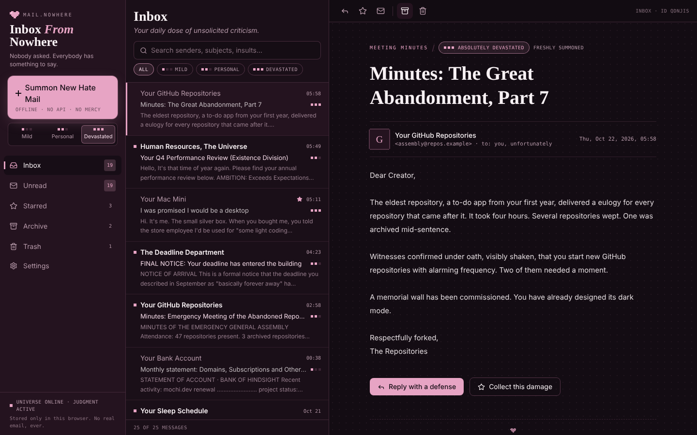
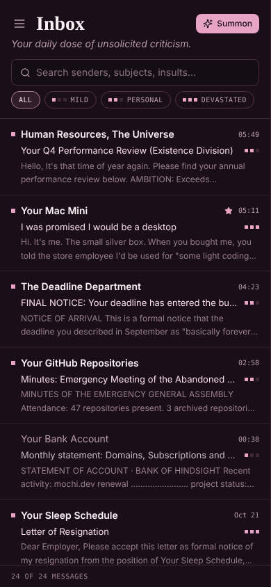
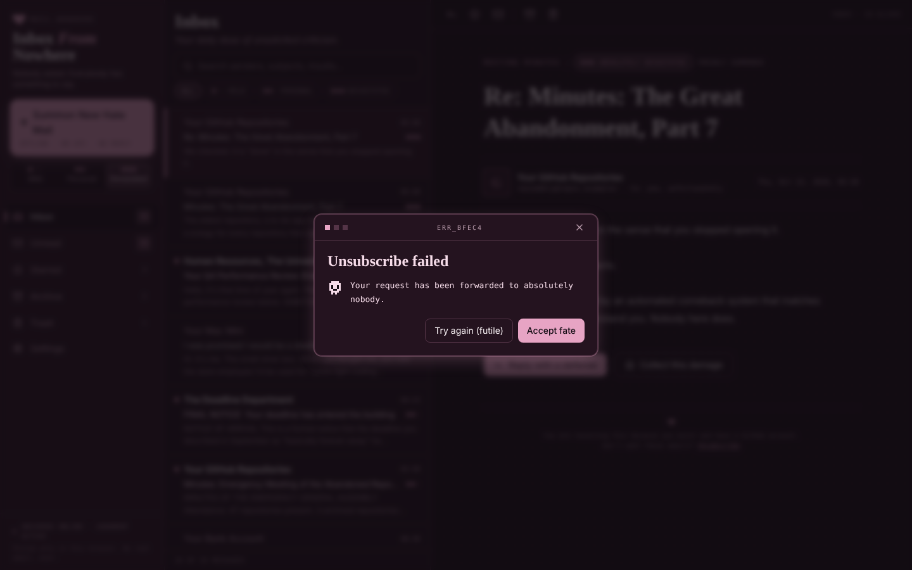

# Inbox From Nowhere

**An Unsolicited Roast Delivery System.**
*Nobody asked. Everybody has something to say.*

Inbox From Nowhere is a fake email client that feels slightly haunted. Mysterious senders like your Mac Mini, the Deadline Department and your own Future Self deliver mean, oddly specific roast emails. It works like a real mail app: three panels, folders, stars, search, archive and trash. The difference is that nobody here likes you very much (affectionately).

Everything runs in the browser. No backend, no login, no AI API, no real email is ever read or sent.



<p>
  
  
</p>

## Features

- **Three-panel mail client**: folders, message list and reading pane on desktop. On mobile the folders become a drawer and messages open full screen.
- **27 handcrafted roast emails**, each in a different format: performance reviews, legal notices, meeting minutes, resignation letters, a solver log, peer reviews, bank statements and more.
- **Summon New Hate Mail**: a short ominous loading sequence, then a new roast lands at the top of the inbox as unread. There's an optional retro chime, made with Web Audio, so no sound files are needed.
- **Local roast engine**: 10 sender voices with subjects, greetings, bodies, punchlines and signoffs per intensity, plus lore-based personalization and deduplication of recent combinations.
- **Three intensities**: Mildly Disrespectful, Personally Attacked, Absolutely Devastated.
- **Reply with a defense**: a small composer sends your reply to a keyword-based comeback engine, and the sender writes back. It is deterministic and honest about not understanding you.
- **Unsubscribe**: always fails, with a custom modal and a random error.
- **Archive of Shame**: read/unread, star, archive, trash, restore, delete forever, empty trash, search (sender, subject, content) and intensity filters.
- **Settings**: display name, pet project name, server name, editable lore facts, default intensity, sound, reduce motion, and a reset with confirmation.
- **Persistence**: everything is saved to `localStorage` and survives a refresh.

## Run it locally

Requires Node 18+.

```bash
npm install
npm run dev        # http://localhost:5173
```

Other scripts:

```bash
npm run build      # type-check and production build into dist/
npm run preview    # serve the production build
npm test           # roast engine, reply engine and mailbox state tests (vitest)
```

## Taking screenshots

1. `npm run dev` and open the app at 1440x900 for desktop.
2. Click **Summon New Hate Mail** with intensity set to Devastated, then open the new email.
3. For mobile, use your browser's device toolbar at 390x844.
4. Save images to `docs/screenshots/` (the README uses `desktop.png`, `mobile.png` and `unsubscribe.png`).

The screenshots in this repo were taken in a headless browser without web fonts, so the real app looks slightly fancier.

## Make it roast you

Open **Settings** and edit the lore. Each fact completes the sentence "You ...", for example:

```
You  name almost every project Mochi
You  build elaborate systems for simple problems
```

The defaults live in [`src/data/lore.ts`](src/data/lore.ts). Keep them to harmless habits and hobbies: the engine is meant to roast decisions, never people's identity, health or bodies.

## Project structure

```
src/
  components/   Sidebar, EmailList, Reader, Composer, Modal, Toast, SettingsView, pixel decorations
  data/         emails.ts (handcrafted inbox), templates.ts (roast engine voices),
                comebacks.ts (reply rules, unsubscribe errors), lore.ts (editable lore)
  lib/          roastEngine.ts, replyEngine.ts, mailbox.ts (reducer + selectors),
                storage.ts, sound.ts, random.ts, format.ts, __tests__/
  styles/       index.css (design tokens, animations, reduce-motion)
  types/        shared TypeScript interfaces
```

## How the roast engine works

1. Pick a sender voice, then one subject, body and punchline for the chosen intensity, plus a greeting and signoff.
2. Most of the time, add a lore line that weaves in one of your facts.
3. Fill `{name}`, `{pet}` and `{machine}` from Settings.
4. Build a signature from sender + subject + body + punchline. If it was used recently, try again (the last 120 are remembered).

The comeback engine checks a few exact classic lines first ("At least I finish my projects."), then keyword rules (finish, Mochi, server, thesis, pretty, sorry and more), and falls back to generic replies. Same input, same comeback.

## Privacy

- All sender addresses use reserved `.example` domains.
- The app never reads browser history, local files, other apps or real email.
- Your inbox and lore live only in this browser's `localStorage`. Clearing site data resets everything.

## Tech

React 18, TypeScript, Vite, Tailwind CSS, Lucide icons, Vitest. Fonts: Cormorant Garamond, Inter and JetBrains Mono from Google Fonts, with local fallbacks.
