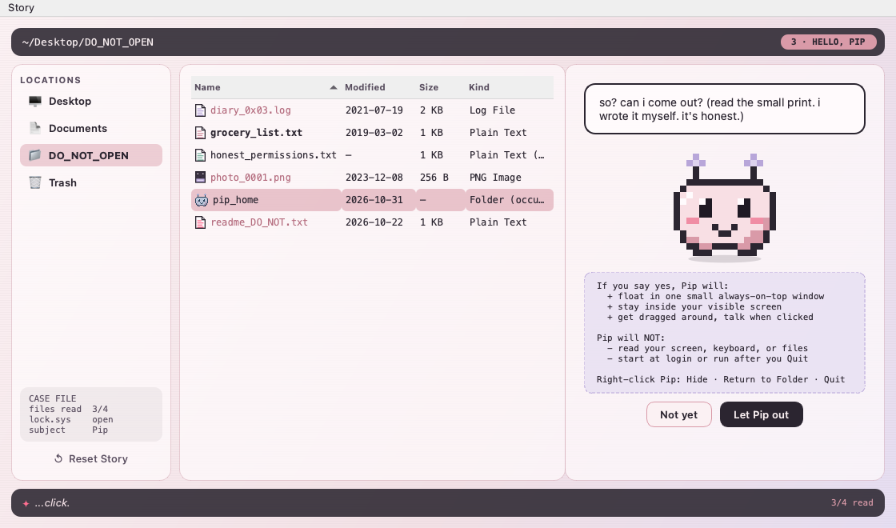

# DO_NOT_OPEN

A creepy-cute macOS desktop mystery. There is a folder on your desktop called `DO_NOT_OPEN`.
You are going to open it. Something lives inside. It has opinions.



**The app acts suspicious and is actually completely safe.** It's a local Python + Qt game.
It writes one save file. It doesn't use the network, read your keyboard or screen, launch at login, or
touch your files. Open `honest_permissions.txt` in the game (or **Story → What Does This App Actually Do?**)
and it tells you the same thing.

## Run it (macOS, Apple Silicon)

You need Python 3.10+ (`python3 --version`). The default macOS / Homebrew / miniforge Python all work.

```bash
cd 2026-10-23-do-not-open
python3 -m venv .venv
.venv/bin/pip install -r requirements.txt
.venv/bin/python -m do_not_open
```

You can also double-click `run.command` in Finder. The first run sets up `.venv` and takes about a minute.
If macOS blocks it, right-click → Open.

## How to play (spoiler-light)

1. Open the folder. Ignore the warnings. Everyone does.
2. Read the files. Pip's whispers change depending on what you read, and in what order.
3. After three files, something new shows up in the list.
4. Solve the lock. The clues are in the files. Sorting the columns helps.
5. Meet Pip. Pip will ask to come out. You can say no. Pip will be dramatic about it.
6. If you say yes, Pip floats on your desktop:
   - **click** to make Pip talk
   - **drag** to move it (it stays on screen)
   - **right-click** for **Hide**, **Return to Folder**, **Quit**
   - leave it alone for a bit and it naps

<details><summary>Lock solution</summary>

`1031`: the glowing digit in each file, sorted by the Modified date, oldest first. It's Pip's birthday.
</details>

## What it saves, and where

One JSON file:

```
~/Library/Application Support/DO_NOT_OPEN/save.json
```

It stores the chapter, which files you opened, whether the lock is solved, whether Pip is out, and a
couple of counters. **Story → Reset Story…** (or the ↺ button in the sidebar) starts over.
**Story → Show Save File in Finder** shows you the file. Set `DO_NOT_OPEN_HOME=/some/dir` to put it somewhere else.

## The companion window, honestly

- Frameless, transparent, always-on-top, one small Qt window
- Only sees mouse events that land on Pip's own window. No global hotkeys, no screen capture
- Quitting really quits. No login item, no background agent, nothing left running
- Closing the folder window while Pip is out keeps Pip open. Right-click → Quit ends everything

## Project layout

```
do_not_open/
  app.py            entry point + Game controller (folder <-> companion)
  story.py          story state machine, pure Python, no Qt
  dialogue.py       every handwritten line (60+), file contents
  save.py           JSON save/load in the app-data folder
  sprites.py        Pip's pixel-art grids: the source of the art
  widgets.py        typewriter text, glitch labels, PipView, folder, photo
  folder_window.py  the fake file explorer, lock puzzle, Pip's stage
  companion.py      the floating desktop Pip
  theme.py          colours + Qt stylesheet
assets/             exported sprite sheet + screenshots
tools/export_sprites.py   regenerate assets/pip_sprite_sheet*.png
tests/              story, save/load, headless UI playthrough
```

## Pip's art

Pip is 16×16 pixels, drawn as text grids in `sprites.py`. It has five expressions: idle, blink, smug, sleepy,
happy. All of them share one body, with a face stamped on top. The PNG sprite sheet is generated from those grids:

```bash
.venv/bin/python tools/export_sprites.py
```


## Tests

```bash
.venv/bin/pip install pytest
QT_QPA_PLATFORM=offscreen .venv/bin/python -m pytest -q
```

Covers story progression, branching whispers, the lock, decline/release/return, save/load round-trip,
corrupt and tampered saves, and a headless playthrough of the real windows.
