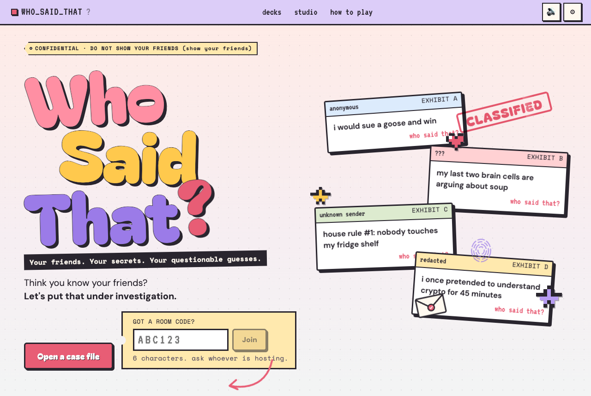
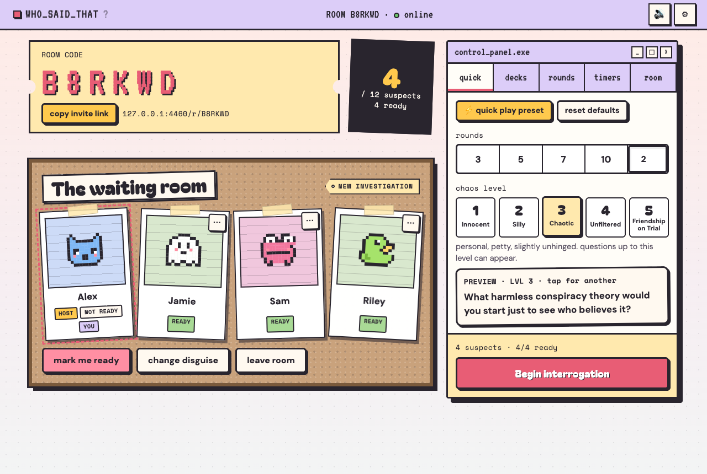
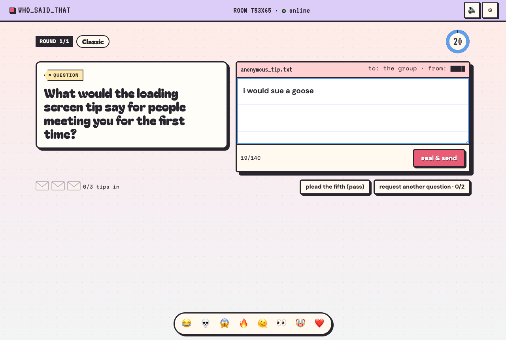
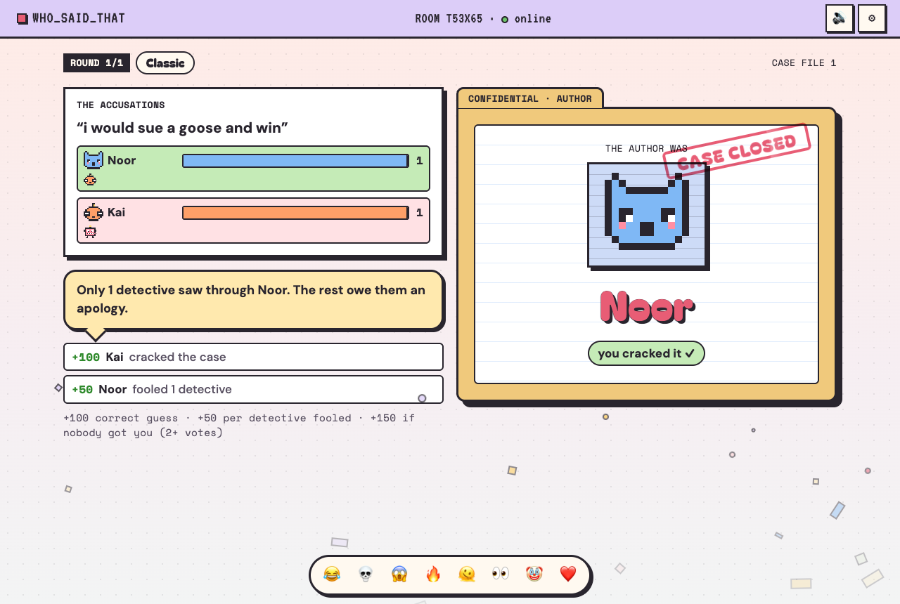
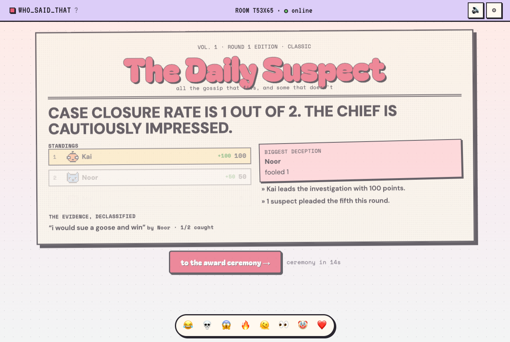
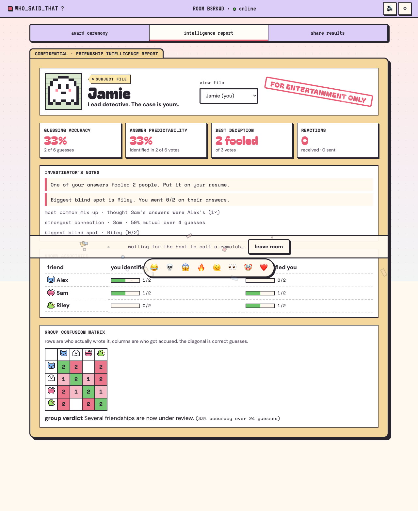
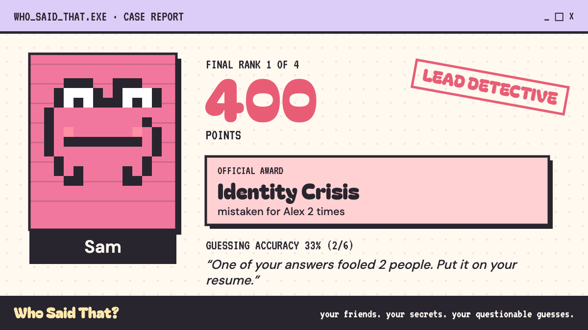

# Who Said That?

your friends. your secrets. your questionable guesses.

a real time multiplayer party game for friend groups hanging out in a discord call. everyone opens a link on their own phone or laptop, answers a question anonymously, then the group tries to work out who wrote each answer. then the case file opens.



## how a game goes

1. the host opens a private room and shares the six character code or the invite link
2. everyone registers as a suspect with an alias, a pixel disguise and a colour
3. a question card flips in and everyone answers in secret
4. answers come back one at a time in a shuffled order and everyone accuses a suspect
5. the reveal shows who got accused, opens the case file, names the author and hands out points
6. after the last round there is an award ceremony, a friendship intelligence report and shareable cards
7. rematch keeps the room and the people

| lobby | answer | reveal |
| --- | --- | --- |
|  |  |  |

| round results | report | share card |
| --- | --- | --- |
|  |  |  |

## what is in it

- 330 hand written questions across 10 decks (33 each) plus 48 special round prompts
- 5 chaos levels from innocent to friendship on trial, filtering every deck
- 10 special rounds that actually change the rules (identity theft, two brain cells, wrong answers only, the alibi, plot twist, pr disaster, anonymous complaints, speed demon, unsent message, final boss)
- anonymous passing and an anonymous "request another question" vote
- scoring on the server with a breakdown on every reveal
- 11 awards computed from what actually happened, with ties and minimum sample sizes
- a friendship intelligence report with accuracy per friend, blind spots, mutual connections and a confusion matrix
- custom decks made in the studio, saved in your browser, importable and exportable as json
- png result cards (personal and group) and a copyable text summary, never including answers
- original synthesised sound effects, volume and mute, reduced motion support
- works on phones, tablets and desktops, keyboard and screen reader friendly

| deck | questions | chaos 1 / 2 / 3 / 4 / 5 |
| --- | --- | --- |
| 01 chronically petty | 33 | 6 / 7 / 8 / 7 / 5 |
| 02 no thoughts, just chaos | 33 | 8 / 9 / 8 / 4 / 4 |
| 03 the group chat files | 33 | 6 / 7 / 8 / 7 / 5 |
| 04 delulu department | 33 | 6 / 7 / 9 / 7 / 4 |
| 05 unfortunately, that's me | 33 | 6 / 8 / 8 / 7 / 4 |
| 06 fight me | 33 | 7 / 8 / 8 / 6 / 4 |
| 07 never leaving this room | 33 | 7 / 8 / 7 / 7 / 4 |
| 08 main character syndrome | 33 | 6 / 8 / 8 / 6 / 5 |
| 09 out of context | 33 | 7 / 8 / 7 / 6 / 5 |
| 10 terminally online | 33 | 7 / 7 / 8 / 6 / 5 |
| case files (special rounds) | 48 | 9 / 12 / 11 / 8 / 8 |

## scoring

| points | for |
| --- | --- |
| +100 | correctly identifying an author |
| +50 | each eligible detective your answer fools |
| +150 | nobody guesses your answer (needs at least two valid guesses) |
| +200 | guessing every answer right in a round (at least two) |
| x2 | everything in the final boss round |

authors never vote on their own answer. missing votes, skipped votes and disconnected players earn nobody points. every point goes through a keyed ledger so a retried event or a reconnect cannot score twice.

## how it is built

- `server/` node, express and socket.io. the server owns rooms, identities, host powers, settings, phases, timers, question picks, the anonymous answer mapping, votes, scores, awards and stats
- `shared/` typed event contracts, zod schemas, the question bank loader and validator, pixel avatar sprites
- `data/decks/` the question bank as typescript data
- `src/` react 19, typescript, vite, framer motion and hand written css
- `tests/` vitest unit and socket integration tests
- `e2e/` playwright tests that drive real browsers

the game is a state machine `LOBBY → QUESTION → ANSWERING → GUESSING → REVEAL → ROUND_RESULTS → NEXT_ROUND → FINAL_RESULTS` (plus `PAUSED`). every transition goes through one function that bumps a step counter, and every client action carries the step it was made in, so stale clicks, double clicks and racing host requests are ignored. clients only show countdowns from server deadlines.

### privacy

each player gets their own projection of the game state. authors are only sent at their reveal, answers are shuffled on the server with random ids, and the count of submitted answers is all anyone sees while answering. nothing is hidden with css. the playwright suite records every websocket frame each browser receives and fails if an author id or someone else's answer shows up early.

other protections include server generated ids, 192 bit reconnect tokens compared in constant time, zod validation on every event, per socket and per ip rate limits, room and spectator caps, answer length and word limits, control and bidi character stripping, a strict content security policy, and no html rendering of user text anywhere.

### disconnects

refreshing or dropping out keeps your seat for 90 seconds (configurable). someone who dropped in the last 15 seconds still counts as "expected", so a refresh does not end the answer phase early, but nobody can hold a round hostage because every phase has a timer. the host role moves on after 25 seconds away, or straight away if the host leaves. late joiners watch as witnesses and join the next game. if fewer than three players remain the game pauses and resumes by itself, or the host can end it and go to results.

## run it locally

needs node 22.18 or newer (node runs the typescript server directly).

```bash
npm install
```

```bash
npm run dev
```

open http://127.0.0.1:5340. the dev script runs the socket server on 5341 and vite on 5340 with a proxy. open more browser windows or private windows to add players.

```bash
npm test
```

```bash
npm run e2e
```

the e2e suite builds the app, starts the production server on 5342 and drives real chrome windows. it uses the installed google chrome by default, set `E2E_CHANNEL=chromium` to use playwright's browser instead. `E2E_BASE_URL=https://your.host` runs it against a deployed copy.

## production

```bash
npm run build
```

```bash
NODE_ENV=production PORT=8080 node server/index.ts
```

one node process serves the built client, the socket.io endpoint and `GET /healthz`. see `.env.example` for every setting (port, host, cors origins, trust proxy, room idle time, room max age, reconnect grace, host grace, max rooms).

rooms live in memory only. restarting the server ends every active game, and idle rooms are deleted after an hour.

### docker

```bash
docker build -t who-said-that .
```

```bash
docker run -p 8080:8080 who-said-that
```

any host that supports long lived websockets works (fly.io, render, railway, a vps behind caddy or nginx). point https at port 8080 and wss works automatically because the client connects to the same origin. if the client is served from a different origin, set `CORS_ORIGINS`.

### on a mac mini

`deploy/launchd.plist.example` runs the server through `scripts/supervise.mjs`, which restarts it within seconds if it crashes. bind it to 127.0.0.1 and put a public https tunnel in front of only that port, for example tailscale funnel

```bash
tailscale funnel --bg --https=10000 http://127.0.0.1:4460
```

funnel has to be allowed for the machine in the tailscale admin console first. a cloudflare tunnel works the same way.

## inviting friends

1. open the public url and press open a case file
2. paste the invite link from the lobby into the discord chat
3. friends open it on their phone, pick a disguise and press enter
4. when everyone shows up, press begin interrogation

## known limitations

- rooms are in memory, so a server restart ends live games
- one server process, no horizontal scaling
- custom decks live in the browser that made them
- reactions count toward the main character award only during reveals
- emoji rendering depends on the device font
